# Skill Management for field service technicians

Hi, I'm Paula, and this is my solution to the [assessment](ASSIGNMENT.md).

The app answers one question for a service manager: who has which skill, backed by which certificate, valid until when. Everything is read from and written to SAP FSM through the proxy you provided. There is no other database.

It also has five small AI helpers. You can ask the matrix a question, it reads the dates from a certificate for you, and it turns a pile of certificates into assignments that you only have to check. I did not just trust them: I measured them, 29 cases, five runs each. More in [The AI part](#the-ai-part).

A hosted copy runs on Vercel. The link and the access code are in my email.

I hope you like it.

Where to find what:

| Where | What |
|---|---|
| This README | A tour, how to run it, the main decisions, limitations, how I used AI tools |
| [docs/decisions.md](docs/decisions.md) | Every decision with its reason and its price, a summary table first |
| [tests/ai-eval](tests/ai-eval) | The cases of the AI evaluation and the result of the last run |
| [samples](samples) | Three files to try the import |
| [AGENTS.md](AGENTS.md) | The rules the coding assistant worked under |
| [Closed pull requests](https://github.com/PaulaGili/skill-matrix-fsm/pulls?q=is%3Apr+is%3Aclosed) | How the work was split, one topic per pull request |

## A quick tour

The screenshots show the demo mode, which runs on invented data. The AI is switched off there, so in the three AI pictures the answer of the model was put in by hand: for "Ask" and "Read dates" the one it gave in the evaluation, for the pile of certificates an example.

### The matrix

One page for everyone and everything. Green is fine, orange needs a look, red is too late. The clip says there is a certificate behind it.

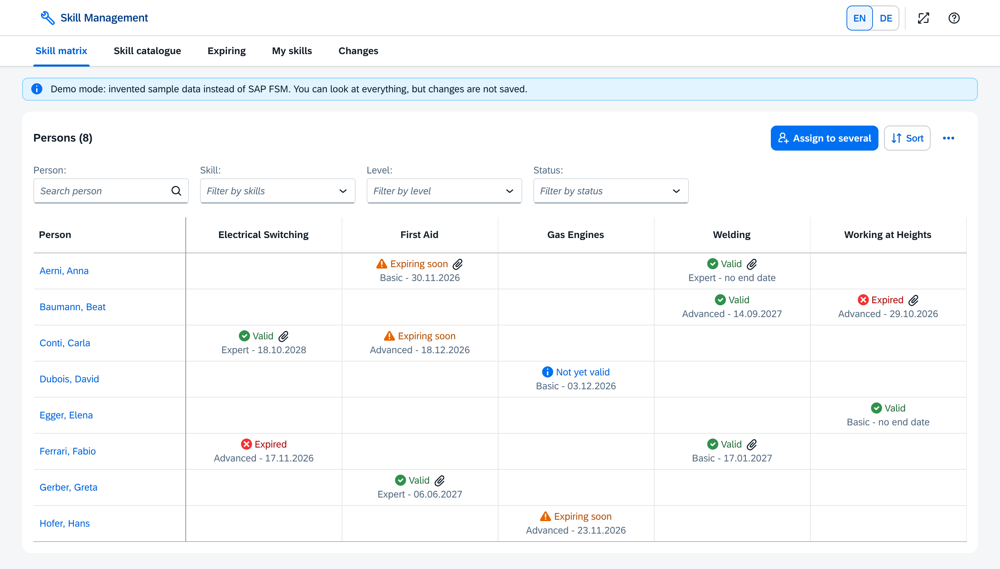

### Ask it a question

Type what you want to know. The AI turns the question into filters, and the app tells you how it understood you. It never sees your persons.

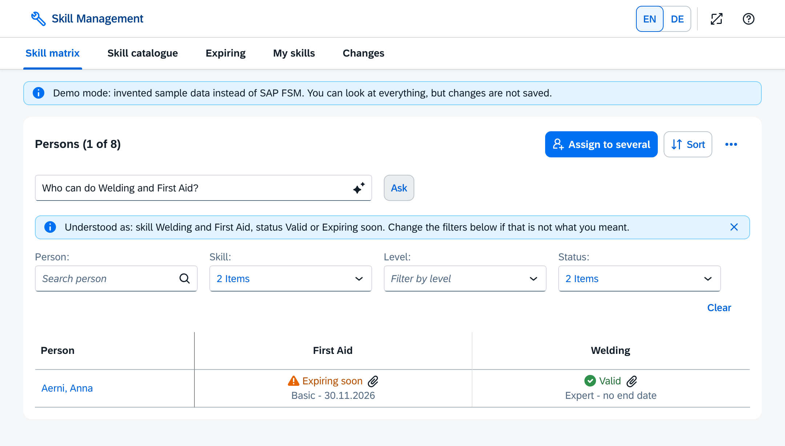

### One dialog for an assignment

Click a cell. Level, dates and certificates are in one place, and nothing is saved until you press Save.

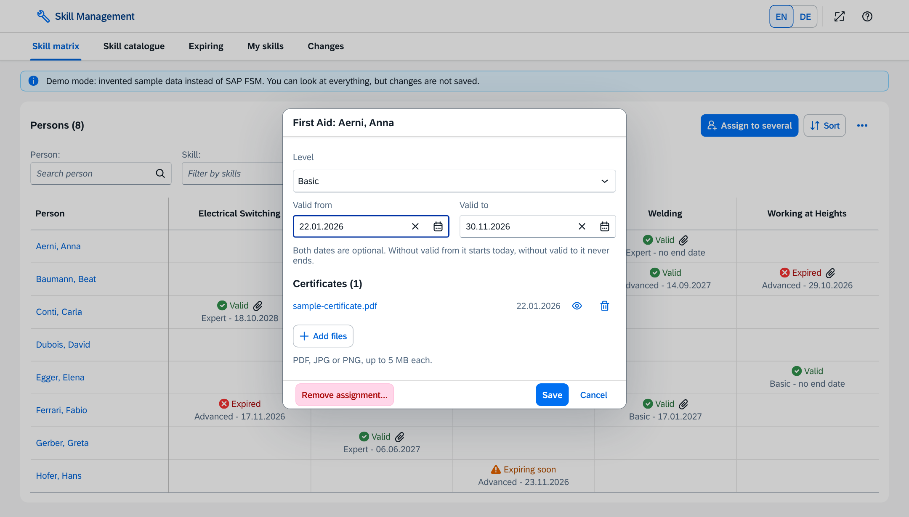

### Certificates you can look at

PDFs and images open right in the app. No download, no searching through folders.

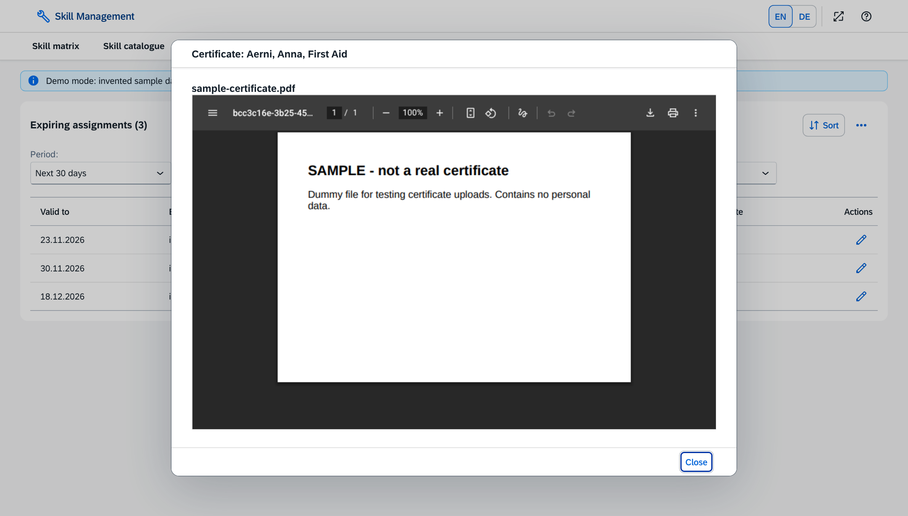

### Let it read the certificate

Upload a certificate and press "Read dates". The AI proposes the dates, the code checks them, and you decide. Here it also noticed that the paper belongs to someone else.

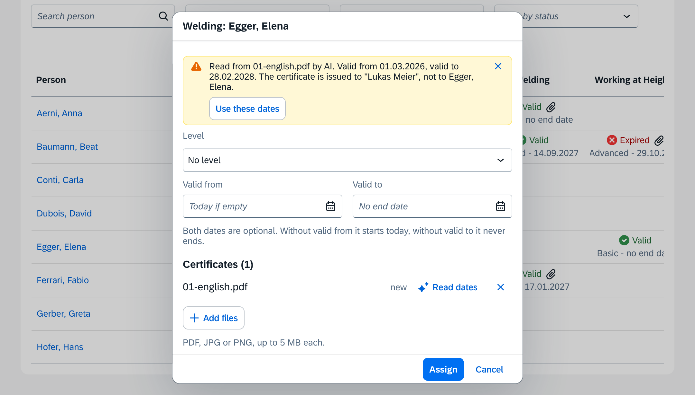

### Everything about one person

Click a name and you see what that technician holds, with level, status and certificates.

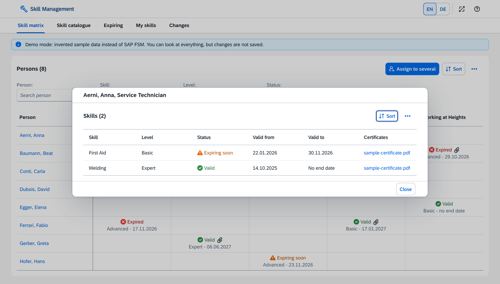

### One skill for the whole crew

After a training day: one skill, several persons, one request. Same dates for all, or dates per person.

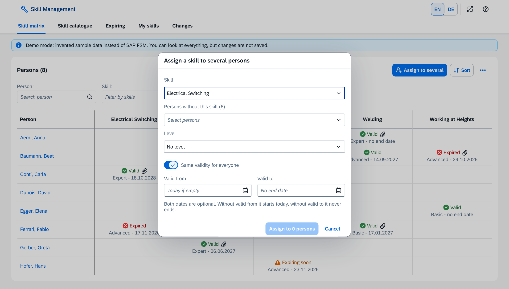

### The catalogue

Create, rename, delete. The number shows how many people hold a skill, and a click on the name shows who.

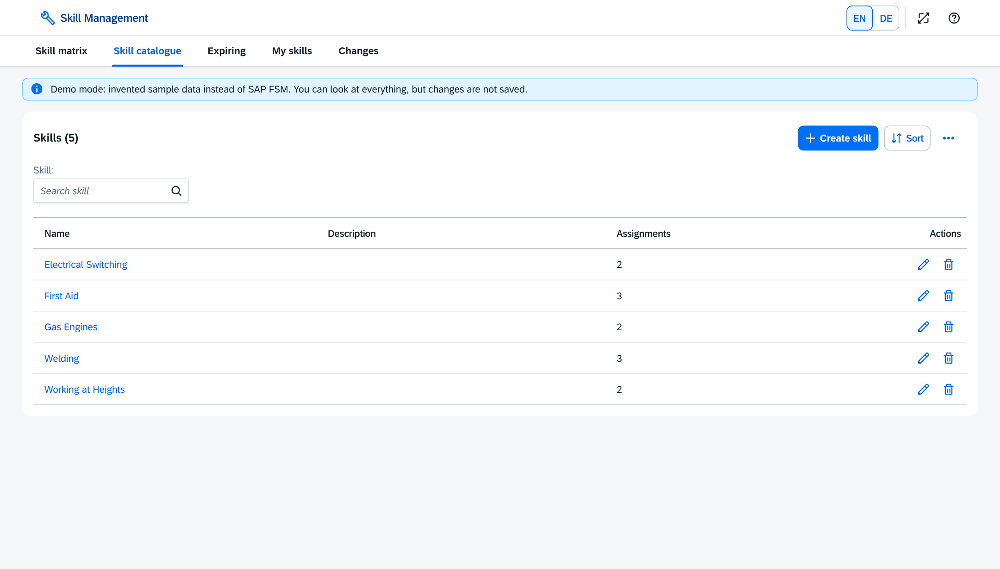

### What runs out soon

The page I would open every Monday. Soonest first, for the next 30 to 180 days, or what has already expired.

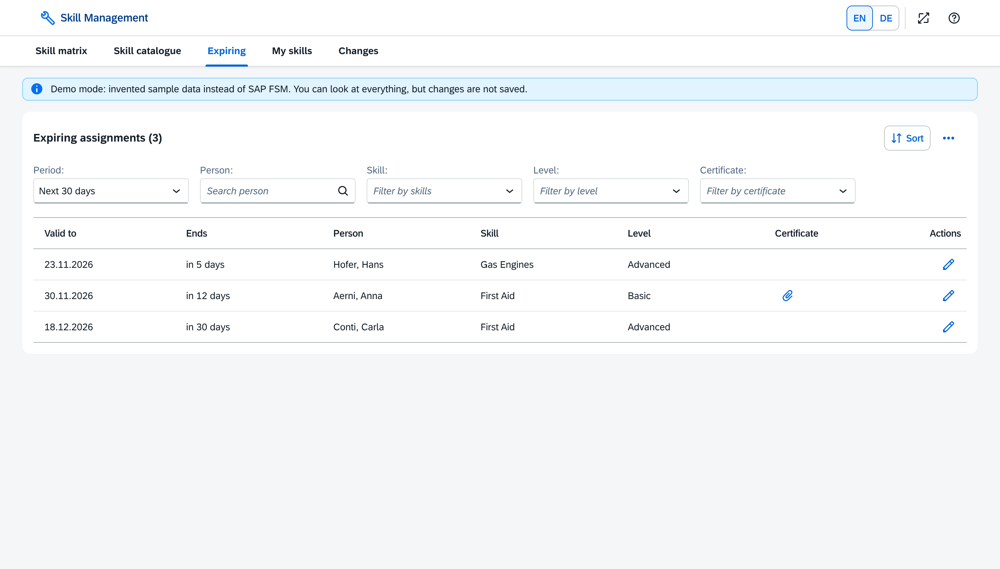

### My skills

For the technicians themselves. Type your name once and see what you hold. Read-only.

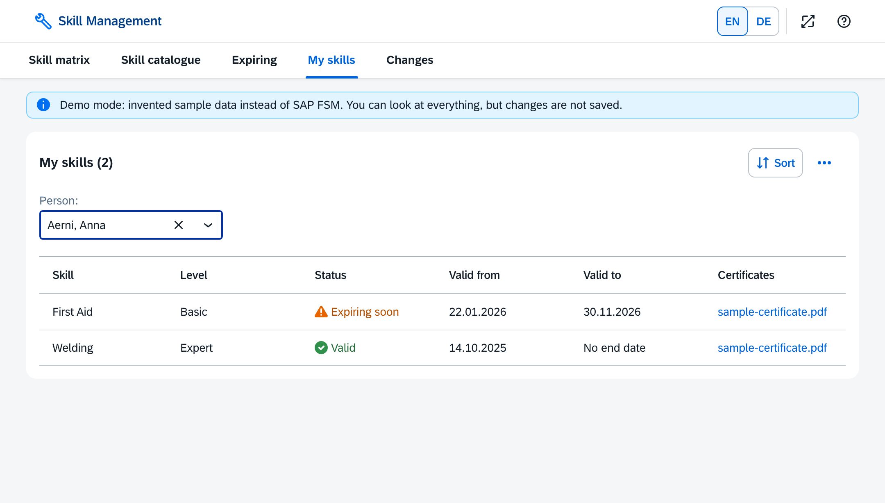

### Import from a spreadsheet

Most teams already keep this list in Excel. Every row is checked and says why it cannot come in, before anything is saved.

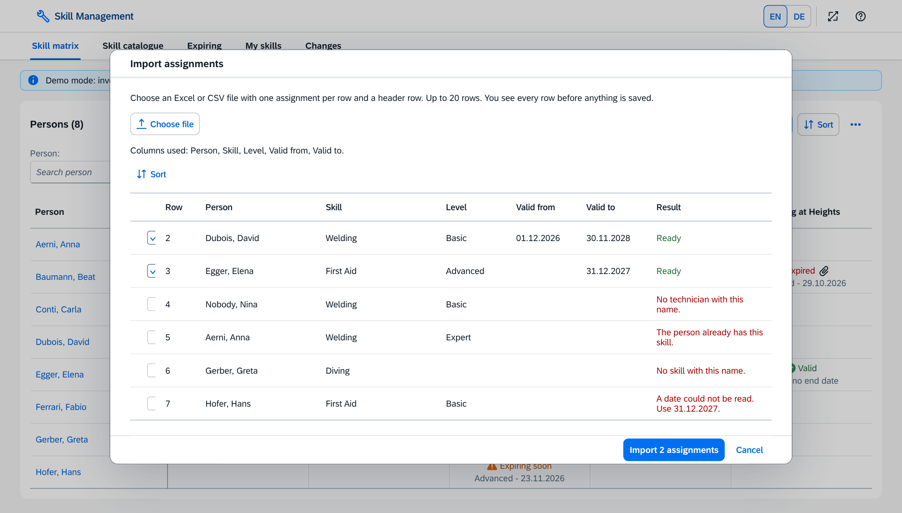

Want to try it? The [`samples`](samples) folder has three files ready, one of them full of mistakes on purpose.

### A pile of certificates

The training centre sends ten PDFs. Choose them all at once: the AI reads holder, skill and dates from each, the code checks every row against FSM, and you tick what goes in. Each file ends up attached to its assignment.

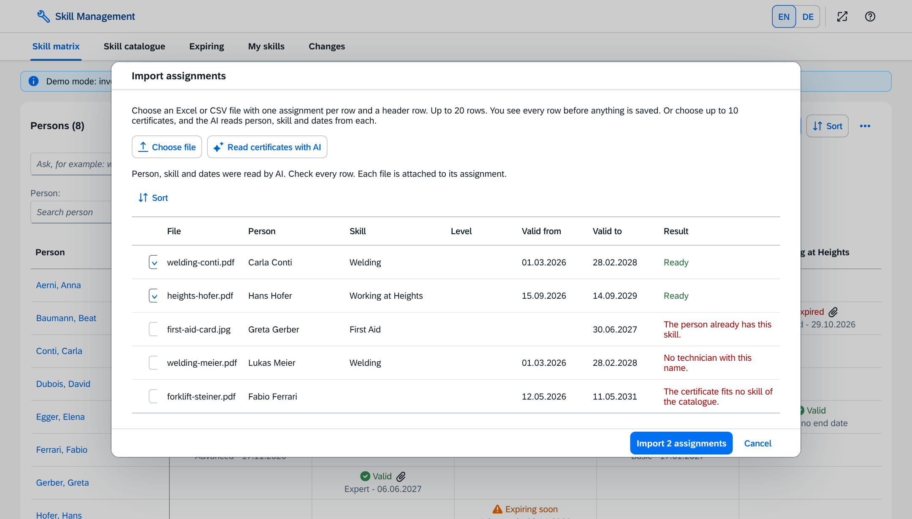

### Auch auf Deutsch

One click and the whole app speaks German, in Swiss spelling.

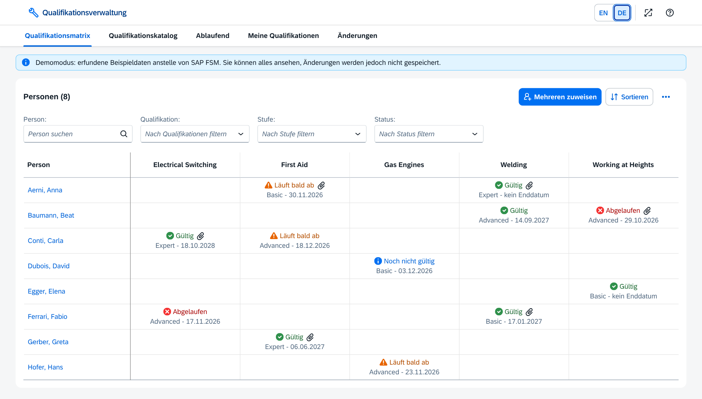

## What is in it

The required scope is complete: skill catalogue, skill matrix, assigning with a validity period, certificates and proficiency levels, with loading, empty and error states.

From the optional list I did the expiry overview, the person view, "My skills", assigning to several persons, export to Excel or CSV, the certificate preview, tests, English and German, the tablet layout and the hosting.

I also added a few things that I thought a real service manager would ask for next:

- import of assignments from Excel or CSV, with every row checked before anything is saved,
- a history of changes with undo,
- five small AI helpers, and an evaluation that measures them,
- a read-only MCP server, so an AI assistant can query the matrix.

Further down I say what I would leave out if I started again.

## Running it

Node.js 22 or newer.

```bash
npm install
cp .env.example .env.local      # set NEXT_PUBLIC_CANDIDATE_ID, leave the FSM values
npm run check:fsm               # checks the connection
npm run dev                     # http://localhost:3000
```

Useful to know:

| Command | What it does |
|---|---|
| `npm run gate` | Everything CI runs: types, lint, format, 146 unit tests, build, a check that no secret is in the browser files, 20 browser tests. Run `npx playwright install chromium` once before it. |
| `npm run seed` | Writes demo data to FSM in your namespace: 7 skills, 13 assignments, 5 certificates. |
| `npm run cleanup -- --yes` | Deletes everything in your namespace. Without `--yes` it only lists it. |
| `npm run smoke` | Runs the service layer against the real company with one throwaway skill. Needs the app running. |
| `npm run eval:ai -- 5` | The AI evaluation. Needs an Anthropic key and costs a few cents. |
| `npm run mcp` | The MCP server. Needs the app running. |

`seed`, `cleanup` and `smoke` write to the shared company, always inside your own namespace.

`.env.example` explains the optional variables: the Anthropic key, demo mode and the access code. The folder `samples` has three files to try the import.

`npm install` reports 16 high severity findings. All of them come from one package, picomatch, used by the test and lint tools, and it has no fixed version yet. `npm audit --omit=dev` reports none, so nothing of it reaches the browser or the server.

## The decisions I thought about most

The full list, each with its reason, is in [docs/decisions.md](docs/decisions.md). These are the ones you asked about.

### Which API for what

| Task | API | Why |
|---|---|---|
| Persons | Query API | One call with filter and sort on the server |
| List of certificates | Query API | One query with joins returns the certificates of all my skills, no call per assignment |
| Skills, scale, levels, assignments | Skill Service | The only API that knows the proficiency level |
| Certificate files | Data API | The only one that handles attachment files |

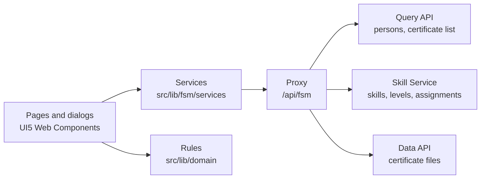

Only the services know the FSM names. The rules (status, dates, filters, import) are pure functions without FSM or React, and that is where most of the unit tests are.

The matrix loads with four calls in parallel, with 10 persons or with 500. The app shell adds a fifth small one that checks the connection.

### Deleting a skill that is still assigned

This is the one I went back and forth on the longest. By default the skill is not deleted but retired: its valid assignments end yesterday and stay in FSM with their certificates. A certificate is evidence, and next year someone may ask whether a technician was certified in 2026. Assignments that only start in the future were never valid, so they are removed.

Deleting everything is possible too. It takes one more step, and you have to type the name of the skill.

### Staying inside my namespace

The proxy limits which entities can be written, but it cannot know whose tag it is. So ownership is checked twice, in two different places.

On the server, a small guard stands in front of the proxy and looks at every write before it is passed on. A tag or scale has to carry my prefix, and anything that is changed or deleted has to be something FSM lists in my namespace. The server reads those ids from FSM itself and trusts nothing the browser sent. An uploaded file has to be a PDF, JPG or PNG of up to 5 MB, here as well as in the browser. A write that the app never makes is refused, and if FSM cannot be asked, nothing is written. Calling `/api/fsm` directly does not get around it.

In the browser, every update and delete reads the record back first. That is where the user gets a clear message, and where the app notices that someone else changed the record in the meantime.

My first version only had the check in the browser. A review pointed out that this is the wrong place to enforce a rule, and it was right. The price of the server check is one to three extra reads per write. Reads are not affected.

A hosted copy still asks for a code. With `APP_ACCESS_CODE` set, nothing is served without it, and a copy on Vercel that talks to the real FSM without a code refuses to work and says why.

### Two things FSM does that surprised me

- It gives every new skill the first level of the scale, whatever you send. "No level" therefore needs one more call that clears it.
- It ignores a new end date on an open-ended skill, without an error, unless `validityType` changes with it.

I found both by testing against the real company, and both are covered by the smoke test.

### Saving in the right order

A save can change the assignment, delete certificates and upload new ones. The assignment goes first, because that step notices if someone else changed it in the meantime, and then nothing else has been touched. My first version deleted the certificates first. A review of that change showed it could leave a certificate deleted after a refused update, so I turned it around.

## Made for a service manager

The design follows SAP Fiori with UI5 Web Components for React and the Horizon theme. A few choices behind what you see:

- A cell shows the status three ways at once, with an icon, a colour and a word, so it also works for someone who cannot tell red from green. Below it are the level and the end date, and a clip when a certificate is attached.
- The person column stays in place while the skills scroll, and the table shows 15 rows at a time. With 25 or more persons the page still does not scroll sideways.
- Picking a skill in the filter also selects "valid" and "expiring soon", because the question behind it is nearly always "who can I send today?".
- All five pages are built the same way: title with the count, the same toolbar, the same filter bar, the table at the same height. What you learn on one page works on the next.
- Each demo person exists twice in FSM, as employee and as system user. The matrix shows the employees and keeps the system users behind the three dots.

I did not have a real service manager to ask. In a customer project that conversation would come before any of the extras.

## The AI part

All five helpers follow the same rule: the AI makes a proposal and a person decides. Nothing the model answers is written to FSM.

| Helper | What it does | What is sent |
|---|---|---|
| Read dates | Reads holder and validity dates from a certificate (PDF, JPG or PNG) | The file and the name of the skill, on a click |
| Ask | Turns a question like "who can do welding?" into filters of the matrix | The question and the names of skills and levels, on a click |
| Match columns | Finds the person and skill columns in a spreadsheet with unusual titles | The titles the code did not recognise, on a click |
| Read certificates | Reads up to ten certificates and proposes one assignment for each, with the file attached | Each file and the names of the skills, on a click |
| Similar skill | Warns when a new skill means the same as an existing one | The new name and the names in the catalogue, when a skill is created |

How it is built:

- All five go through one function on the server, using the Anthropic SDK and the model `claude-haiku-5-5`.
- The answer is requested as structured output against a zod schema, so its shape is guaranteed by the API and nothing is parsed from free text.
- The code then checks the content: a skill or level that does not exist is dropped, dates must be real dates in the right order, a column title must be one of the titles in the file, and a name read from a certificate must be exactly one technician.
- Each call has a time limit of 25 seconds, and there is a cap on calls per hour.
- The key stays on the server. Without it the helpers are simply not shown.
- Every prompt says that the input is data, and each helper has a test case that tries to give the model an instruction.

Persons and assignments from FSM are never sent. A certificate is the one case with personal data, so under the GDPR and the Swiss FADP a real installation needs a data processing agreement with the provider, and a word to the technicians, before "Read dates" and "Read certificates" are switched on.

### Measuring it

"It seems to work" was not enough for me, so `npm run eval:ai` calls the real model with 29 known cases and compares the result. With `-- 5` every case runs five times and counts only if all five are right. The last result is in [tests/ai-eval/last-run.txt](tests/ai-eval/last-run.txt): 29 of 29, between 1.2 and 1.6 seconds per call.

Running it several times showed me two things I had not expected:

- Two cases passed in one run and failed in the next, with the same model: the column title "MA", and a question that asks for a status and a missing certificate at once. I made both prompts clearer and added control cases with wording the prompt does not mention, to see that the fix is general.
- I had started with the strong model for certificates, assuming a scan needs it. Then I compared both on seven certificates, two of them made to look like phone photos. Same answers, 1.4 instead of 1.9 seconds, at a fraction of the cost. So the app now uses one small model. The two runs are in [tests/ai-eval/model-comparison.txt](tests/ai-eval/model-comparison.txt).

The newest helper, reading certificates for the import, has seven cases of its own, one of them a licence for a skill that is not in the catalogue. They were added after that run, so the file does not show them yet.

To be fair, the cases are few and I made them myself. I know the prompts work on these inputs. I do not know yet how they do on every scan a technician will upload.

### MCP server

`npm run mcp` starts a server with four read-only tools: which skills exist, who holds a skill, what a person has, and what expires soon. It reads through the running app, uses the same rules as the matrix, and has no tool that writes.

To connect an assistant, with the app running:

```json
{
  "mcpServers": {
    "skill-matrix": {
      "command": "npm",
      "args": ["run", "--silent", "mcp"],
      "cwd": "/path/to/this/repo"
    }
  }
}
```

It hands the names and skills of the technicians to whichever assistant is connected, so connecting one is a decision for the person who does it.

## Tests and CI

- 146 unit tests on the pure rules: statuses and dates, filters, import, export, the ownership checks in the browser and on the server, and the access code.
- 20 browser tests against the production build with FSM mocked in the browser, so they need no credentials and never touch the shared company. They walk through the required scope: catalogue, assigning, editing, certificates.
- A smoke test against the real company for the things only FSM can answer.
- GitHub Actions runs `npm run gate` on every pull request, the same command as on my machine.

## Libraries I added

| Library | Why |
|---|---|
| `zod` | Checks what comes into the AI routes and describes the answer the model has to give |
| `read-excel-file`, `write-excel-file` | Import and export of real .xlsx files in the browser, small and without a server step |
| `@anthropic-ai/sdk` | The five AI helpers |
| `@modelcontextprotocol/sdk` | The MCP server |
| `vitest`, `@playwright/test` | Unit and browser tests |
| `prettier`, `tsx` | One code format, and running the TypeScript scripts |

There is no data fetching or state library. The app loads four lists and reloads them after a save, and one small hook (`useAsyncData`) covers loading, error and reload. English and German are two typed dictionaries of about 290 texts, which did not justify an i18n library.

## What I would do differently

- Start smaller. The import and the MCP server taught me a lot, but a real login would have been worth more to a customer.
- Test the AI with real scans from real technicians, with their consent.
- Raise the limit of 20 rows per import. It is there because of the rule about bulk imports in the shared company; the preview can already be sorted for longer files.

## Known limitations

- The hosted copy accepts files up to about 3 MB. A file travels as base64 inside a JSON request, and Vercel cuts a request at 4.5 MB. Locally the 5 MB limit holds.
- The history of changes is kept in the browser, because FSM has no change log and the assignment allows no other database. Another computer does not see it.
- "My skills" has no login. The technician picks the name from a list.
- If the extra call that clears the level fails, the new assignment keeps the level "Basic" without a warning. I have not seen it happen.
- On a phone the matrix scrolls sideways. It is fine for looking something up, and a click on a person lists that person's skills below each other.
- The fixed person column and the dragging of columns use parts of the UI5 table that are still marked experimental.
- The cap on AI calls per hour is counted in memory, per server.
- The certificate link was tested in Chrome. The preview and the download were not tried in Firefox or Safari.

## How I used AI tools

I built this with Claude Code. It wrote most of the code, the tests and the first drafts of the docs. I work with it like with a fast junior colleague: it writes, I decide, and I don't trust a result until something else has checked it. Here is how that looked in this project.

- **I wrote the rules down first.** `AGENTS.md` has them: the layers, the names, how dates are handled, and that any FSM behaviour has to be tried on the real company before the code relies on it. With the rules in place the output was much more even, and easier to review.
- **Every commit goes through the same gate.** `npm run gate` runs types, lint, format, unit tests, the build, a scan of the browser files for secrets and the browser tests. CI runs the same command. If it is red, the change stays out, no matter who wrote it.
- **I checked FSM myself.** The assistant is very sure about APIs it has never called. So for everything this repository says about FSM, I created a throwaway object in my namespace, tried it and wrote down what happened: the level FSM forces on a new skill, the end date it quietly ignores, the bulk route that keeps the level.
- **Someone else reviews.** Whoever wrote a change is the worst person to review it, and I found that is true for a model as well. The two agents in `.claude/agents` start without knowing how the code was built. One reads it like an engineer who sees it for the first time, the other scores it against your assignment. Before submitting I ran two rounds with several reviewers at once, each with one job. Two of them had to run things instead of reading: one cloned the repository into an empty folder with another candidate id and ran the gate, the other connected a real MCP client and called every tool with nasty input.
- **I don't take a reviewer's word either.** Some findings were wrong and I left the code alone, like the advice to drop the second ownership check when deleting. And one fix I did apply caused a new bug, in the order of a save. The next round caught it.
- **I broke things to test the tests.** For the tests I added late, I changed the code so it was wrong and made sure they went red.
- **The AI features got the same treatment.** That is what the evaluation is for. It asks every case several times, because a single run of a model tells you very little.

Working like this is fast, and speed is the easy part. A model sounds just as sure when it is wrong, so the real work is saying exactly what you want, checking what you get and deciding what to leave out.
